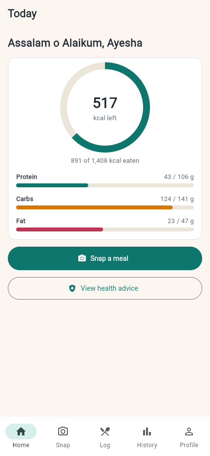
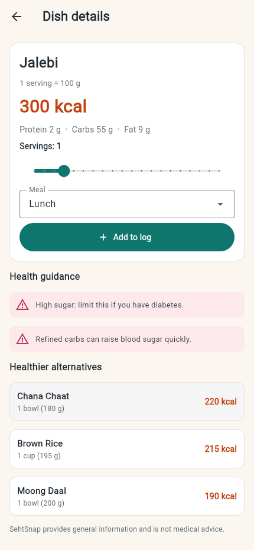
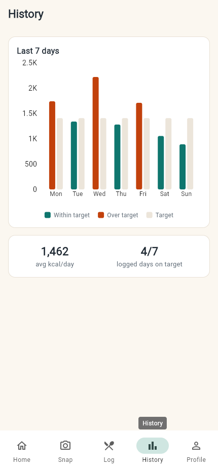
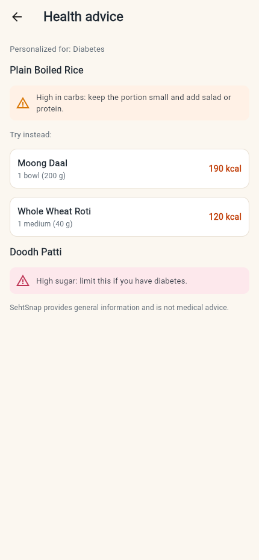

# SehtSnap

**Snap a photo of your desi meal and see its calories, macros and health guidance.**


> **Disclaimer:** SehtSnap provides general information and is **not medical advice**. Nutrition values are estimates. Talk to a qualified healthcare professional about your diet.

## Live Demo

Open the [SehtSnap web app](https://sehtsnap-web-524589711748.asia-south1.run.app), create an account, and snap or upload a meal. The web app and Gemini API run on Google Cloud Run.

## About the Project

Most nutrition apps are built around Western packaged food, so biryani, nihari, daal chawal and karahi are often missing or inaccurate. **SehtSnap focuses on South Asian food.** It recognizes dishes from a photo, understands English, Urdu and Roman Urdu names, estimates nutrition, and adds guidance for people managing diabetes, high blood pressure or high cholesterol.

## Features

- Onboarding, signup and login
- Profile with age, gender, height, weight, activity, goal and health conditions
- Daily calorie and macro targets using Mifflin-St Jeor
- AI food detection with Gemini or OpenAI
- Fuzzy matching across 74 dishes and their aliases
- Top suggestions and manual search when detection is uncertain
- Adjustable servings and meal logging
- Daily log with calorie ring and macro bars
- Seven-day calorie history
- Rule-based health warnings and healthier alternatives
- Settings for AI provider, units, log reset and logout
- Demo mode that works without Firebase

## Tech Stack

| Area | Technology |
| --- | --- |
| Language | Python 3.11+ |
| UI | Flet, flet-charts |
| Auth and data | Firebase Auth and Firestore REST APIs with `httpx` |
| Demo storage | SQLite |
| AI vision | Gemini (`google-genai`) or OpenAI (`openai`) |
| Validation | Pydantic |
| Matching | RapidFuzz |
| Images | Pillow |
| Quality | pytest, ruff, type hints |

## Screenshots

| Home | Dish details | History | Health advice |
| --- | --- | --- | --- |
|  |  |  |  |

Screenshots use fictional demo data.

## Folder Structure

```text
main.py                   Flet entry point
src/sehtsnap/
  core/                   Config, theme, routes, state and units
  services/               Auth, storage, AI, nutrition, calculator and advice
  models/                 Pydantic models
  screens/                App screens
  widgets/                Reusable UI components
backend/                  FastAPI service that protects the Gemini key
assets/data/              South Asian nutrition dataset
scripts/seed_demo_data.py Demo account and meal logs
tests/                    Unit tests with mocked AI and network calls
screenshots/              README images
```

## Run Locally

```bash
git clone https://github.com/khizarsys/sehtsnap-nutrition-app-python.git
cd sehtsnap-nutrition-app-python
python -m venv .venv
```

Activate the environment:

```bash
# Windows PowerShell
.\.venv\Scripts\Activate.ps1

# macOS or Linux
source .venv/bin/activate
```

Install and configure:

```bash
pip install -r requirements.txt
cp .env.example .env      # Windows PowerShell: Copy-Item .env.example .env
python scripts/seed_demo_data.py
flet run main.py
```

With no Firebase values, the app starts in demo mode. Sign in with `demo@sehtsnap.example` and `demo12345`. If Firebase is configured, set `DEMO_MODE=true` in `.env` to use the demo account.

### Run in a Browser

```bash
flet run --web main.py
```

### Build an Android APK

Prerequisites are the Flutter SDK and Android SDK required by your Flet version. See the [Flet Android publishing guide](https://flet.dev/docs/publish/android).

```bash
flet build apk
```

`.env` is not packaged. To enable cloud sync and AI detection in the APK, deploy the backend, add `AI_BACKEND_URL` to `.env`, then run:

```bash
python scripts/write_app_config.py
flet build apk
```

The generated `assets/app_config.json` contains only public client settings. It never contains a Gemini or OpenAI key.

## Gemini Backend

The FastAPI service in `backend/` keeps the Gemini key on the server. It verifies Firebase ID tokens, validates images, applies per-user and daily limits, and returns the same detection JSON used by the app.

Run it locally:

```bash
pip install -r backend/requirements.txt
cp backend/.env.example backend/.env
uvicorn --factory backend.app.main:create_app --port 8080
```

Build the container from the repository root:

```bash
docker build -t sehtsnap-api .
```

Set `GEMINI_API_KEY` and `FIREBASE_PROJECT_ID` as secrets on your host. Usage limits are stored in memory, so run one instance or replace them with a shared store before scaling out.

## Running Tests

```bash
pytest
ruff check .
```

Tests do not make real AI or Firebase calls.

## Firebase Setup

1. Create a project in the [Firebase Console](https://console.firebase.google.com).
2. Enable **Authentication > Sign-in method > Email/Password**.
3. Create a **Firestore Database** in production mode.
4. Publish these rules so users can only access their own data:

```text
rules_version = '2';
service cloud.firestore {
  match /databases/{database}/documents {
    match /users/{userId}/{document=**} {
      allow read, write: if request.auth != null && request.auth.uid == userId;
    }
  }
}
```

5. Register a Web app and copy its `apiKey` and project ID into `.env`.

## Environment Variables

| Variable | Required | Description |
| --- | --- | --- |
| `AI_PROVIDER` | No | `gemini` (default) or `openai` |
| `GEMINI_API_KEY` | For Gemini | Google AI Studio API key |
| `OPENAI_API_KEY` | For OpenAI | OpenAI API key |
| `AI_BACKEND_URL` | For mobile AI | Deployed SehtSnap API URL |
| `GEMINI_MODEL` | No | Overrides the default Gemini model |
| `OPENAI_MODEL` | No | Overrides the default OpenAI model |
| `DEMO_MODE` | No | `true` forces local demo storage |
| `FIREBASE_API_KEY` | For cloud sync | Firebase Web API key |
| `FIREBASE_PROJECT_ID` | For cloud sync | Firebase project ID |

## Design Decisions

- **Flet:** one Python codebase can target desktop, web and mobile.
- **Firebase REST:** `firebase-admin` is server-only and must not ship inside a client app.
- **Demo mode:** anyone can clone and run the project without creating cloud services.
- **UI-independent logic:** calculator, matching, advice and AI parsing are unit-tested without Flet.
- **Strict AI contract:** model output is validated with Pydantic, and failures fall back to manual search.
- **Frozen log values:** entries keep their nutrition values even if the dataset changes later.

## Future Improvements

- Persistent sessions and saved preferences
- Barcode scanning and custom recipes
- Multiple dishes in one photo
- Urdu interface
- Dietitian-reviewed nutrition data

## Author

**Khizar Hayat** — BS Software Engineering, Riphah International University
LinkedIn: [linkedin.com/in/khizar-hayat-dev](https://linkedin.com/in/khizar-hayat-dev)
